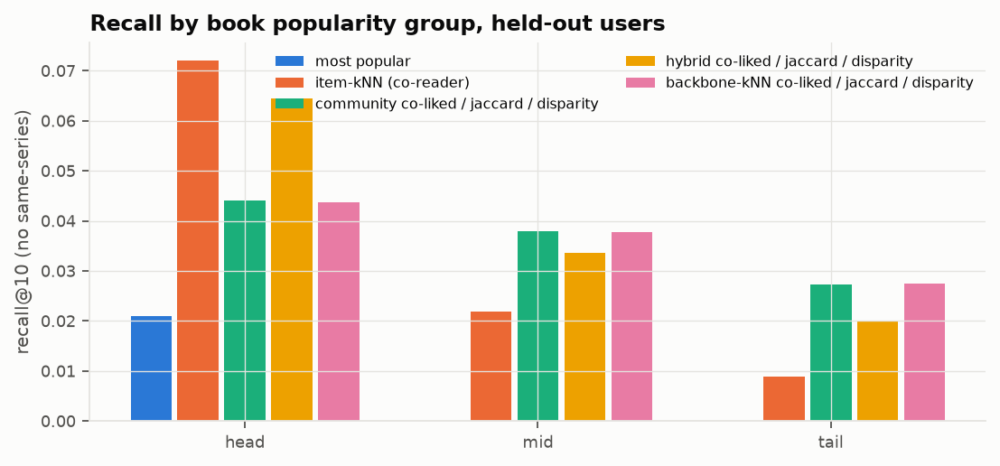

# Reader Communities for Long-Tail Book Recommendations

*Draft of 2026-11-10. Editable version: the Claude Docs report. Limit: 11,000 characters excluding spaces (this draft: about 9,300).*

02807 Computational Tools for Data Science, final project. Group members: Evelina Haite, Ana Rita Ferreira, Yuktha [surname], Vishwaa [surname], [fifth member, if any].

## Summary

"Readers also bought" recommendations work for bestsellers but rarely surface niche books, and they cannot recommend new books with no readers at all. We test whether reader communities found by graph clustering do better. The data is a user-based sample of 4.4M Amazon book reviews. The pipeline:

1. merges duplicate editions with MinHash LSH
2. builds co-reader and co-liked book graphs from 1.7M training reviews, weights the edges with Jaccard and PPMI, and keeps a disparity-filter backbone
3. clusters the backbone with Louvain and with our own spectral clustering
4. recommends books from each user's communities and evaluates on the held-out 2014 reviews
5. handles new books with SBERT similarity, searched with random-hyperplane LSH

The graph recommenders find long-tail books 3× more often than purchase overlap (recall@10 0.027 vs 0.009, significant). The communities are coherent (modularity 0.84). But the gain comes from the weighted backbone rather than from the community step (Section 5).

- **Course topics:** similar items / LSH, and graph clustering (Louvain, spectral clustering, modularity).
- **Outside the course:** the disparity filter, PPMI, and SBERT sentence embeddings.

## 1. Problem

Co-purchase overlap rewards books that many people already bought, so a few bestsellers dominate the lists. Most of a catalogue is a long tail of books with few readers, which is where a recommender adds the most value. Graph clustering offers another signal: books read by the same group of readers form a community, even when each book has few readers. We ask three questions:

1. Do such communities recommend long-tail books better than purchase overlap alone?
2. Are the communities meaningful?
3. Can new books with no readers be placed using their text?

## 2. Data and preprocessing

A teammate pulled the Amazon Books reviews and metadata (McAuley et al., 2014 release). The sample is taken by user, not by review: about 50% of users were drawn and all of their book reviews kept, so each reader's full history is available. Users and books with fewer than 2 entries were removed. The result is 4,408,904 reviews by 301,553 users of 349,741 books (2.3 GB), dated 1996 to July 2014.

The data is skewed:
- **Users:** the median user has 8 reviews; the heaviest has 15,761.
- **Books:** 78% have no genre label, and there is no author field.
- **Reviews:** 69% are from 2012 or later.

Reviews serve as a proxy for purchases. All processing is done out of core with DuckDB and sparse matrices.

- **Duplicates:** the same book often exists as several editions. MinHash LSH on character 3-shingles of the title found 10,728 candidate pairs. Pairs that also had the same normalised title and similar SBERT descriptions were merged: 819 pairs, leaving 348,922 books. The cold-start part uses this mapping. The graph results below were computed before it existed, with every edition kept as its own book.
- **Time split:** reviews before 2014-01-01 are training data. Reviews from January to July 2014 are the test set (24% of reviews).
- **Iterative k-core:** users with ≥ 5 and books with ≥ 15 reviews, repeated until both hold. After 15 iterations, 2.29M reviews, 165k users and 52k books remain.
- **Liked:** a review counts as liked if its rating is ≥ 4 (80% of reviews).

## 3. Method

### 3.1 Book graphs

From the user × book matrix B we compute C = BᵀWB, blockwise in sparse form, never as a dense all-pairs matrix. Two graphs come out of it:
- **co-reader:** built from all reviews (7.0M edges)
- **co-liked:** built from liked reviews only (4.0M edges)

Edges need at least 2 shared users. Each user is weighted by w = 1/log(1+d), where d is the number of books they read. Without this, the 34 users with more than 500 books would create 17.5% of all book pairs.

We implemented three edge weights:
- **raw** shared-reader counts
- **Jaccard:** |Uᵢ∩Uⱼ| / |Uᵢ∪Uⱼ|, which corrects for popularity
- **PPMI:** max(0, log(Cᵢⱼ·T / (rᵢ·rⱼ))), which scores pairs that co-occur more often than chance

### 3.2 Backbone: the disparity filter (outside the course)

The graphs are too dense to cluster well, and a single global weight threshold would erase the long tail. The disparity filter (Serrano, Boguñá & Vespignani, 2009) instead tests each edge locally. For a book i with k edges and total weight s, the null model splits s uniformly at random over the k edges. Under that null, an edge with share p = w/s is at least this heavy with probability α = (1 − p)^(k−1). An edge is kept if α is below the threshold for either endpoint, so every book keeps its own strongest links.

At a fixed α = 0.05, raw weights keep 47% of books but PPMI only 3%. PPMI weights are nearly uniform around each node, so few PPMI edges ever look significant. We therefore compare backbones at a matched edge budget: the same number of edges as each book keeping its 10 strongest neighbours (top-10). We implemented the filter, the edge-budget matching and the top-10 baseline ourselves.

### 3.3 Clustering

**Louvain** (igraph) is run on the main backbone (co-liked graph, Jaccard weights, disparity filter) for resolutions 0.5–20 with 5 seeds each. At resolution 1, modularity peaks at 0.84. Partitions from different seeds agree with NMI 0.83.

**Spectral clustering** is our own implementation. We take the 60 smallest eigenvectors of the normalised Laplacian I − D^(−1/2)WD^(−1/2) of the 43.7k-book giant component with scipy's eigsh, row-normalise them and run k-means. It reaches modularity 0.71–0.75, so Louvain is used downstream.

Our modularity function matches networkx and igraph to 8 decimal places.

### 3.4 Recommenders and evaluation

**Community recommender.** It takes books from the communities of the books a user liked before the cut-off. Inside a community, books are ranked by their backbone links to the user's own liked books. Ranking by centrality, as first planned, gave every reader in a community the same books and scored below "most popular".

**Baselines.**
- **Most popular:** the most-read books the user has not read.
- **Item-kNN:** sums raw co-reader counts with the user's liked books. This is purchase overlap, i.e. "readers also bought".

**Hybrid.** A mix of the two: (1−λ)·kNN + λ·community.

**Evaluation.** We report hit, recall and NDCG at 10 on books liked in January–July 2014, for 74,715 test users. Results are split by book popularity: head, mid and tail each hold one third of the training interactions. Books from a series the user already read are excluded, which replaces a same-author check since there is no author field.

Resolution, ranking and λ were chosen on 20% of the test users. Every number reported is on the other 80%, with paired bootstrap confidence intervals.

### 3.5 Cold start

A new book has no readers. For each of 9,108 books first reviewed after the cut-off, we predict which established books its readers also read. Hit@10 is measured on a held-out half of these books. Book text (title, description, categories) is embedded two ways: TF-IDF reduced to 128 dimensions with SVD, and SBERT (all-MiniLM-L6-v2). The nearest established books are found by exact cosine search or with random-hyperplane LSH.

## 4. Results

**Communities.** NMI against Amazon genres is 0.29, versus 0.06 for random partitions of the same sizes, measured on the 18% of books that have a genre. 12 of the 39 large labelled communities mix genres in ways that make sense to readers:
- post-apocalyptic thrillers with prepper manuals
- clean romance with Christian fiction
- paranormal teen romance
- M/M romance

**Long-tail recommendation** (59,392 held-out users; same-series books removed; 95% CIs):

| Method | Recall@10 | Head | Mid | Tail | Coverage |
|---|---|---|---|---|---|
| Most popular | 0.008 | 0.021 | 0 | 0 | 0.04% |
| Item-kNN (purchase overlap) | 0.035 | **0.072** | 0.022 | 0.009 | 47% |
| Community | 0.039 | 0.044 | **0.038** | **0.027** | 82% |
| Hybrid, λ = 0.5 | **0.041** | 0.064 | 0.034 | 0.020 | 73% |
| Backbone-kNN (no communities) | 0.039 | 0.044 | 0.038 | 0.027 | 84% |

- **Community vs item-kNN:** +9% recall overall (CI +6% to +13%) and 3.1× tail recall.
- **Item-kNN's lists:** 81% of its recommendations are bestsellers, against 38% for the community recommender.
- **Hybrid:** +16% overall, losing only 11% on the head.
- **Weighting:** Jaccard beats both raw counts and PPMI. PPMI gives popular books rare, unrelated neighbours.
- **Series:** removing same-series books lowers recall by 8–11%.

**Cold start** (hit@10 on the test half of new books):

| Method | Hit@10 |
|---|---|
| Most popular | 0.458 |
| Popular within genre | 0.411 |
| TF-IDF + SVD similarity | 0.309 |
| SBERT similarity | 0.411 |
| SBERT + popularity, λ = 0.5 | **0.482** |
| SBERT via LSH (9 bits × 30 tables) | 0.395 |

The LSH search recovers 72% of the exact top-10. Hit rate grows with the number of readers a new book eventually gets: 0.27 for books with 3–5 readers, 0.90 for books with more than 25.

## 5. Discussion

The method works for its main goal. Weighted, sparsified reader graphs recommend long-tail books far better than purchase overlap and cover more of the catalogue, and the hybrid keeps most of the head performance.

The **community step itself** adds no accuracy. A backbone-kNN that ignores communities scores the same (difference +0.0001, CI −0.0003 to +0.0004). At resolution 1, 91% of the backbone's edge weight already lies inside communities, so restricting candidates to the user's communities removes almost nothing. At finer resolutions more edges are cut and validation recall falls slightly.

So the gain comes from the Jaccard weighting and the local backbone. Clustering contributes interpretable reader communities, the cross-genre findings, and a compact description of the graph: 412 communities instead of 309k edges. Its natural role is the cold start, where a new book has no graph edges: assigning it to a community through its text is the next step, and the evaluation code for this is already prepared.

For new books, adding popularity to text similarity beats both alone. TF-IDF misses meaning that SBERT captures.

**Limitations.**
- The data is from 2014, and reviews are only a proxy for purchases.
- The graph results do not yet use the duplicate-edition merge.
- Only 18% of books have a genre label.
- The series check is approximate.
- Choices were validated on a split of users, not on a later time period.
- Sentiment-based liking: [to be added by the sentiment owner].

## Contributions

| Member | Contribution |
|---|---|
| Evelina Haite | Repository; metadata cleaning; TF-IDF and SBERT embeddings; MinHash LSH duplicate detection |
| Ana Rita Ferreira | Data exploration and filtering scenarios; content-similarity prototype |
| Yuktha [surname] | Cold-start evaluation: new-vs-established split, baselines, SBERT + popularity, random-hyperplane LSH |
| Vishwaa [surname] | Data inspection; graph construction, weighting, disparity filter, Louvain and spectral clustering, community recommender and evaluation |
| [member] | [sentiment analysis] |

**Appendix:** the notebooks `notebooks/graph_clustering.ipynb`, `1_cold_start_data_prep.ipynb` and `2_cold_start_evaluation.ipynb`, with instructions, at github.com/evelinaha/02807_computational_tools_ds.
